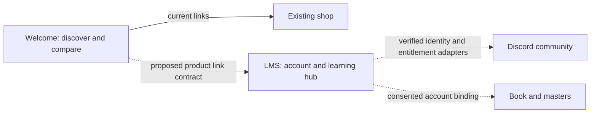

# Welcome and LMS handoff

Inventory checked November 2, 2026. Repository state and a running deployment are
different facts; verify both when starting work.

| Component | Authoritative source | Verified baseline |
|---|---|---|
| Welcome public storefront | `zftribe/tr_landingpage` | `main` at `1ebbbe2c9c314be3deaf529554adbae5e8e65850` |
| LMS profile, learning and checkout | private `zftribe/LMS` | `main` at `8b1fa826176c073c6ab8fa3b4dce2d0f3940180b` in the signed-in repository inventory |

`zftribe` and `ZFT-Zeefreaks` are different GitHub accounts. Do not clone or publish
to a similarly named repository just because another account is active. Do not
transfer ownership or invite collaborators as part of routine code work.

## Ownership of responsibilities

Solid line is current page behavior. Dotted lines describe integration work that
needs verification; they do not claim live shared sign-in, rewards or account
binding. Welcome must not store member tokens, personal learning profiles,
gateway secrets or staff permissions. LMS must enforce product prices and access
on the server; a Welcome label, QR code or browser redirect is not proof of access.

## What is ready for review

- Existing Welcome page and assets, unchanged by this handoff branch.
- Local preview tooling and this documentation.
- A proposed course-family Base/MAX comparison exists in a separate design review.
  It is not merged into this repository or a replacement for approved offer terms.
- Additional LMS hub, security, analytics, referral and transactional-commerce work
  was prepared locally, with a reported 46-test synthetic suite. Its local snapshot
  commits are not remote LMS commits. Until a reviewed branch/PR is linked in the
  private LMS handoff, do not assume that work is available in a fresh clone or live.

## Working together with Claude or another agent

1. Clone the correct repository and read these docs before editing. Verify
   `git remote -v`, `git status --short`, and the current `origin/main` revision.
2. Preserve existing changes. Use one short feature branch per reviewable change;
   never force-push another developer's branch or replace the repository with a ZIP.
3. Keep the current storefront and the LMS integration proposal distinct. Include
   screenshots, exact destinations, test results and unresolved decisions in the PR.
4. Review a local or verified Vercel preview before release. Use synthetic records
   for LMS flows. A successful public page load does not verify a private checkout.
5. The owner reviews release readiness. A developer's repository access does not
   imply permission to change billing, secrets, account access or production data.

## Access and dependencies

Reading public Welcome source is available without an invitation. Editing it
requires existing repository write access; LMS also requires separate private
repository access. The inventory was unable to reverify the collaborator list
because GitHub requested reauthentication. Verify the developer's exact GitHub
identity before any permission changes; do not infer it from an email address or
from commit authorship. No invitation or permission change is part of this branch.

GitHub production deployment history records a Vercel deployment for the Welcome
baseline under `tr-lms-vercel`. The repository About link still names an older
`jay-ows-projects` alias. Confirm the current project/team, domain mapping and
auto-deployment behavior in the owner dashboard before release. Do not change DNS
or hosting settings just to resolve an old documentation link.

The private LMS handoff should link its architecture, environment-variable names,
migration order, isolated staging setup, test evidence, rollback boundaries and
feature status. Keep sensitive implementation findings and account configuration
inside the private repository or approved credential system, not this public repo.
