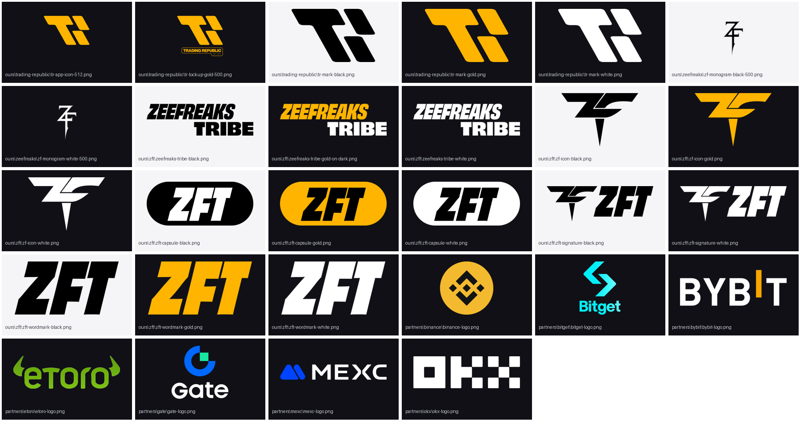

# Trading Republic · ZFT logo library

Every logo the team uses for posters, slides, Discord banners and partner posts, in one place.


This folder is **not** served by the website (it sits outside `public/`), so nothing here goes live by accident.

```
brand/logos/
├─ ours/
│  ├─ trading-republic/   TR mark (gold, black, white) + lockup + app icon
│  ├─ zft/                ZFT wordmark, ZFT capsule, ZF icon, signature, Zeefreaks Tribe
│  └─ zeefreaks/          George's personal ZF monogram
├─ partners/<name>/       one folder per partner
└─ manifest.json          machine-readable list (the poster maker reads this)
```

## Our marks

| File | Use it on | Notes |
| --- | --- | --- |
| `trading-republic/tr-mark-gold.svg` / `.png` | dark backgrounds | **Primary TR mark.** Gold `#FFB400`. |
| `trading-republic/tr-mark-white.svg` / `.png` | dark or busy photos | mono white |
| `trading-republic/tr-mark-black.svg` / `.png` | light backgrounds | mono black |
| `trading-republic/tr-lockup-gold-500.png` | dark backgrounds | mark + "TRADING REPUBLIC BY ZFT" badge. **Only 500 px**: fine for Discord and small corners, not for big print. Ask the designer for the master file. |
| `trading-republic/tr-app-icon-512.png` | app tiles, avatars | the site's app icon |
| `zft/zft-wordmark-{black,white,gold}` | headers, poster top bar (as on Charts Decoded, The Hunt, The Council) | the slanted "ZFT" |
| `zft/zft-capsule-gold` | **ZFT submark**: dark backgrounds | gold pill, black letters (the logo in the ZFT intro videos) |
| `zft/zft-capsule-white` / `-black` | light / dark | same pill in mono |
| `zft/zf-icon-{black,white,gold}` | icon-only spots, favicons, stamps | the ZF arrow mascot |
| `zft/zft-signature-{black,white}` | formal pieces | ZF icon + ZFT |
| `zft/zeefreaks-tribe-{black,white,gold-on-dark}` | formal paperwork, merch | full "ZEEFREAKS TRIBE" wordmark |
| `zeefreaks/zf-monogram-{black,white}-500.png` | George's personal posts only | 500 px only; not a TR/ZFT team mark |

Every SVG scales to any size. Every PNG in `ours/` is 2,400 px on the long side with a transparent background (except the 500 px files noted above).

### The poster pairing used today
Recurring session posters (Charts Decoded, The Hunt, The Council) put **ZFT wordmark + TR mark side by side in white**, top right or top centre. Keep that pairing.

### Rules
- **Clear space:** keep empty space around a logo equal to the height of the "Z" in ZFT (for the TR mark: the width of its small right-hand bar). Nothing (text, edges, other logos) inside that zone.
- **Minimum size:** TR mark 32 px tall on screen; ZFT wordmark 24 px tall.
- **Dark backgrounds:** gold or white. **Light backgrounds:** black (or gold on white only when the gold stays readable).
- **Never:** stretch, rotate, recolour outside gold/black/white, add shadows or outlines, or put the gold mark on a yellow or orange photo.
- **Footer on posters:** the brand footer is an adaptive pill only (tinted, translucent, matched to the art). No solid band and no "Template:" credit.
- **Brand colours:** Yellow Tribe `#FFB400`, Slick Black `#000000`, Bright White `#FFFFFF` (ZFT Style Guide 2021). The welcome site uses a softer gold `#F9A825` on near-black `#0B0B0F`.

### Fonts
| Where | Font | Licence for us |
| --- | --- | --- |
| ZFT wordmark | *Obviously* (OH no Type Co.) | **Paid.** The logo files are outlines, so you don't need the font to use the logo. For new headline text use **Archivo Black** or **Anton** (Google Fonts, free). |
| Welcome site headings | Plus Jakarta Sans | Google Fonts, free |
| Welcome site body | DM Sans | Google Fonts, free |
| Event posters (Monthly Meetup etc.) | heavy condensed + brush script | use **Anton** + **Permanent Marker** (Google Fonts, free) |
| Team font folder | Anton, Poppins, Righteous (`D:\Workspaces\zft-fonts`) | Google Fonts, free |

### Where our files came from
- **TR mark SVG:** traced on 7 Nov 2026 from the official 4K master `TR-Logo-Black-on-White-4K.png` (zeefreaks-brand `media/logos/TR/`). Colour sampled from the official gold PNG: `#FFB400`. If the designer has the original vector, swap it in.
- **ZFT, ZF icon, signature, Zeefreaks Tribe SVGs:** taken directly from the vector outlines in *ZFT StyleGuide.pdf* (2021, George's files). These are original artwork, not traced.
- **TR lockup, app icon:** this repo's `public/` (`TR no BG.png`, `icon-512.png`).
- **ZF monogram:** zeefreaks-brand `media/logos/ZF/zflogopng.png`.

## Partners

Files are the ones already shown in the Trusted Partners reel (branch `codex/trusted-partner-cards`, `public/partners/`). They are correct marks but small, and where they came from wasn't recorded. **Before any big or printed use, ask the partner manager for the master file** and drop it into that partner's folder.

The hand-drawn SVGs in `public/logos/*.svg` are rough redraws (they set the name in a system font). **Do not use them for posters.** They are not copied here.

| Partner | Status | File | Get the official kit from |
| --- | --- | --- | --- |
| OKX | active partner | `partners/okx/okx-logo.png` (748 px, white) | OKX partner/affiliate manager (no public press kit found) |
| Binance | Trusted Partners reel | `partners/binance/binance-logo.png` (288 px, icon) | Binance partner manager |
| Bitget | Trusted Partners reel | `partners/bitget/bitget-logo.png` (360 px) | press: media@bitget.com · Bitget Wallet kit: https://web3.bitget.com/en/docs/resource/brand-kit/ |
| MEXC | Trusted Partners reel | `partners/mexc/mexc-logo.png` (474 px, white) | press: media@mexc.com |
| Bybit | Trusted Partners reel | `partners/bybit/bybit-logo.png` (476 px, white) | Bybit partner manager |
| Gate | Trusted Partners reel | `partners/gate/gate-logo.png` (383 px) | Gate partner manager |
| XM | past partner | `partners/xm/xm-logo.svg` | XM partner manager |
| eToro | past partner | `partners/etoro/etoro-logo.png` (540 px) | eToro partner manager |
| **OKX Wallet** | sponsor prospect | **to get from partner** | OKX partner manager |
| **DragonFi** | sponsor prospect | **to get from partner** | DragonFi marketing (press releases on help.dragonfi.ph link to hi-res assets) |
| **Meteora** | sponsor prospect | **to get from partner** | Meteora team (no public kit found on meteora.ag) |

Partner rules: use a partner logo only for a real, current partnership or a past one labelled "past"; never change its colours; give it the same clear space as ours; put it in a "with" or "partner" slot, never larger than the TR/ZFT mark.

## Adding or replacing a file
1. Put it in the right folder, named `<brand>-<variant>-<colour>.<ext>`.
2. Add a line to `manifest.json` and to the tables above, with where it came from.
3. Open a PR. Don't commit files whose source or rights are unclear; list them as "to get from partner" instead.
